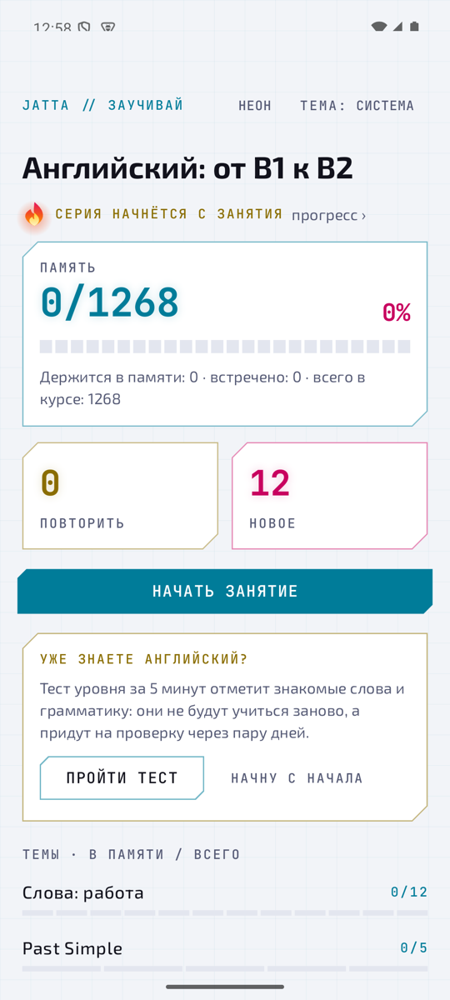
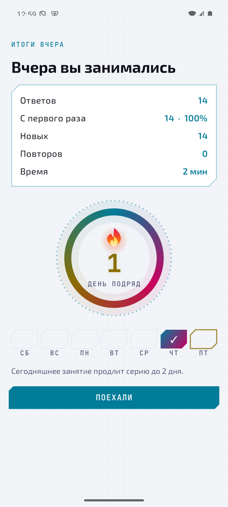
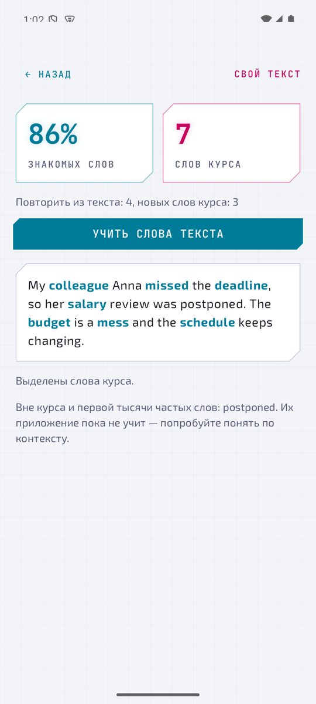
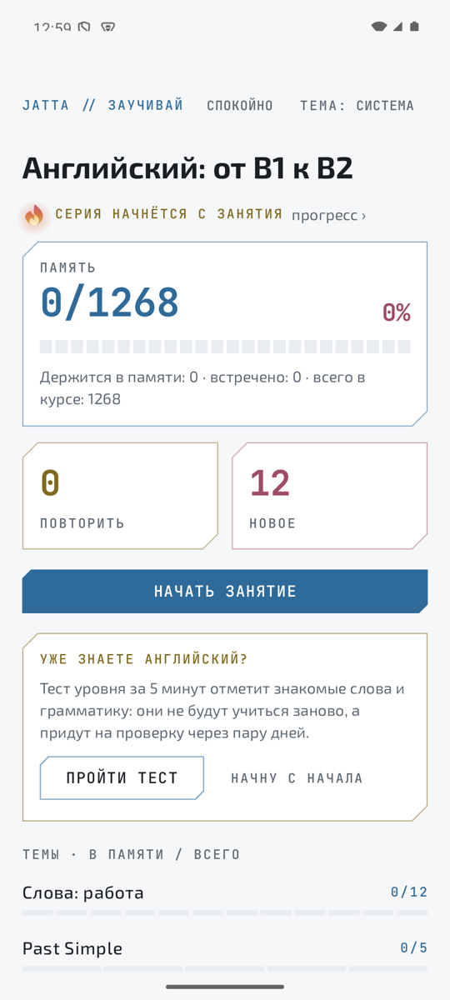

# Jatta — ИИ-учебник английского без сервера

**Jatta** (каз. «заучивай») — приложение для Android, которое учит английскому от B1 к B2 так, как советует наука о памяти, а не маркетинг. Повторы ставит алгоритм FSRS и подгоняет его под вашу память. Свободные ответы и разговор проверяет модель на самом телефоне. Аккаунт, подписка и сервер не нужны: всё, что вы написали и сказали, остаётся на вашем устройстве.

Скачать: [последний релиз, `Jatta.apk`](https://github.com/kuanish-dev/Jatta/releases/latest). Нужен Android 8+; для ИИ-проверки — 64-битный телефон и 5,5 ГБ памяти.
Страница для учеников: [docs/index.html](docs/index.html) ([опубликовано](https://claude.ai/artifact/MGVNvztgYHHXoK2R8zcYr6)). Научная основа и все 28 механик: [docs/mechanics.html](docs/mechanics.html) ([опубликовано](https://claude.ai/artifact/1rr8HKEgen5H7N3BP9XS3j)).

<p>
 
 
 

</p>

## Чем Jatta отличается

| | Jatta | Обычное приложение |
|---|---|---|
| Когда повторять | FSRS-6 предсказывает вашу память; интервал подбирается под вероятность вспомнить 90% | фиксированные ступени или «сердечки» |
| Точность модели памяти | видна на экране «Точность прогноза»: что обещала модель и что вы вспомнили | не показывается |
| Параметры памяти | подгоняются под ваш журнал ответов (оптимизатор py-fsrs, порт на Kotlin) | одни на всех |
| Проверка свободного ответа | модель на телефоне (Gemma 4 / Gemini Nano), и только после того, как она прошла тест точности | сервер или нет проверки |
| Разговор по-английски | собеседник с характером на телефоне, разбор ошибок под каждой фразой | платная функция или нет |
| Усталость и перерывы | монитор усталости по точности и скорости, перерывы по расписанию, тихий отдых после нового | бесконечные стрики |
| Данные | ничего не уходит с телефона, журнал ответов — обычный JSON | аккаунт и сервер |
| Код и контент | GPL-3.0, темы курса — открытые JSON-файлы, можно подключить свой курс | закрыто |

## Что внутри

- **Курс** — объём учебника уровня Intermediate: 68 тем, 1268 единиц. Темы слов (работа, деньги, поездки, техника, люди, чувства, здоровье, еда, дом и город, учёба, покупки, природа, кино и книги, спорт, семья, фразовые глаголы), частотные наборы NGSL с 1001-го по 2809-е слово, 24 темы грамматики, сверенных с English Grammar Profile (B1–B2), и 251 фраза на слух с записями носителей.
- **Лестница упражнений**: узнавание → пропуск → перевод → своя фраза → вслух. Ступень зависит от стабильности памяти, лестница сдвигается по вашей точности.
- **Тест уровня** за 5 минут: 60 слов «знаю / не знаю» с псевдословами против угадывания и по два вопроса на тему грамматики. Знакомое заводится в память и приходит на проверку через пару дней.
- **Чтение**: отрывки из Simple English Wikipedia и книг Project Gutenberg, где ≥95% слов знакомы.
- **Перевод фраз** в конце занятия: пары Tatoeba, проверка chrF++ против переводов людей, спорное решает модель или вы.
- **Ответ голосом** на верхней ступени: распознавание речи только на телефоне (Android 12+).
- **Серия, итоги дня, прогресс**: календарь, график памяти по дням, разделы курса.
- **Свой текст**: вставьте статью или письмо, приложение найдёт в нём слова курса, покажет долю знакомых и соберёт занятие из слов текста.
- **Свои темы**: JSON-файл по формату из `docs/course-format.md` добавляется в конец курса прямо в приложении.
- **Напоминание** одно, без настроек: на ближайший день, где есть что учить, в ваше обычное время. Виджет на рабочий стол показывает, сколько повторить и выучить сегодня.
- **Два оформления**: неон и спокойное, каждое в светлой и тёмной теме.

## Как это работает, коротко

1. Движок (`engine`) решает, что, когда и сколько учить. Это чистый Kotlin без часов, базы и сети: FSRS, план дня, очередь занятия, лестница, отдых.
2. Слой занятия (`study`) загружает контент, строит упражнения, проверяет ответы, пишет журнал `answers.jsonl` и ведёт экраны.
3. Интерфейс (`shared`, Compose Multiplatform) только рисует экран и зовёт контроллер.
4. ИИ только проверяет свободные ответы и ведёт разговор. Перед тем как ему доверить ответы, приложение прогоняет его на 120 фразах с известным ответом; ниже 90% совпадений — сверяете сами.

Каждое число в движке помечено механикой и уровнем доказательности: таблица в [CLAUDE.md](CLAUDE.md), раздел «Настройки и их основания». Слабые значения подгоняются по журналу ученика.

## Приватность

- Нет аккаунта, нет сервера, нет аналитики. Интернет нужен один раз — скачать модель (2,6 ГБ).
- Голос распознаётся на телефоне. Разговор с ИИ живёт только в памяти и не пишется в журнал.
- На телефонах с Gemini Nano приложение использует Google ML Kit, а он приносит служебную телеметрию Google (`datatransport`). Это единственное, что может уйти с устройства, и это не ваши ответы.
- Прогресс можно сохранить в файл («Данные» на главной) и загрузить на другом телефоне; журнал ответов — ваш.

## Сборка

```bash
export JAVA_HOME=/opt/homebrew/opt/openjdk@17/libexec/openjdk.jdk/Contents/Home
./gradlew :engine:jvmTest :study:jvmTest
./gradlew :androidApp:assembleDebug
```

Нужны JDK 17 и Android SDK (путь в `local.properties`). iOS-код компилируется (`:shared:compileKotlinIosSimulatorArm64`), но приложение для iPhone ещё не собрано.

Эмулятор: `emulator -avd <имя> -no-audio`, затем `adb install -r androidApp/build/outputs/apk/debug/androidApp-debug.apk`.

## Свой курс

Темы курса — JSON-файлы в `content/en/`. Формат описан в [docs/course-format.md](docs/course-format.md); свою тему проверяет `python3 -I scripts/check_topic.py тема.json`, а в приложение она добавляется кнопкой «Тема из файла». Загрузчик проверяет файлы и отказывается грузить битые; тест `ContentTest` строит упражнение на каждой ступени для каждой единицы настоящего курса.

## Контент и лицензии

- Код: GPL-3.0-or-later с разрешением на связывание с Google ML Kit ([LICENSE](LICENSE), [THIRD_PARTY_NOTICES.md](THIRD_PARTY_NOTICES.md)).
- Частотный список NGSL 1.2 (CC BY-SA 4.0) — ранги слов и список форм первой тысячи (`content/en/basic-words.json`) для разбора своих текстов.
- Фразы на слух: Tatoeba, записи CC BY 4.0 / CC BY-SA 4.0, переводы CC BY 2.0 FR. Автор и лицензия показываются при первой встрече.
- Тексты: Simple English Wikipedia (CC BY-SA 4.0), Project Gutenberg (общественное достояние).
- FSRS: порт py-fsrs 6.3.2 (MIT).
- Шрифты Exo 2 и JetBrains Mono (OFL).

## Как помочь

- Пройти курс и прислать журнал: папка данных приложения или экспорт с главного экрана. На живых журналах подгоняются параметры памяти и проверяются пороги.
- Вычитать контент: `content/en/topics/*.json`, перевод фраз в `content/en/sentences.json`.
- Сделать свою тему или курс по формату из `docs/course-format.md`.
- Issues и pull requests: https://github.com/kuanish-dev/Jatta.
